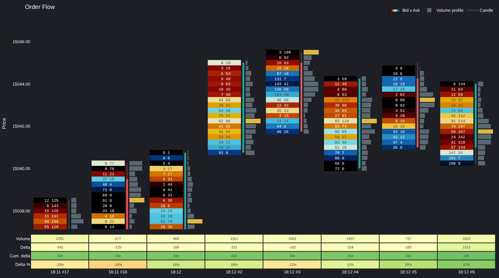

# OrderflowChart

[](https://github.com/murtazayusuf/OrderflowChart/actions/workflows/tests.yml)

Footprint (order flow) charts in Python, rendered with Plotly.

Each candle shows bid x ask volume at every price level, coloured by imbalance,
with the candle itself and a per-candle volume profile (point of control
highlighted) beside it. A lower panel shows volume, delta, cumulative delta and
delta % per candle.



## Install

```bash
pip install git+https://github.com/murtazayusuf/OrderflowChart
```

Requires Python 3.9+, pandas 1.5+ and plotly 5.9+ (tested up to pandas 3 and plotly 6).
Optional extras: `[live]` for the Dash example, `[image]` for PNG export via kaleido.

## Quick start

```python
import pandas as pd
from OrderFlow import OrderFlowChart

orderflow = pd.read_csv("data/time_candles.csv", index_col=0, parse_dates=True)
ohlc = pd.read_csv("data/time_ohlc.csv", index_col=0, parse_dates=True)

chart = OrderFlowChart(orderflow, ohlc)
chart.plot()                              # opens in the browser / notebook
fig = chart.plot(return_figure=True)      # or get the plotly Figure
```

`python main.py range` and `python main.py time` plot the two bundled samples.

## Input data

You need two DataFrames.

**ohlc_data**: one row per candle, columns `open`, `high`, `low`, `close`.

**orderflow_data**: one row per (candle, price level), columns `price`,
`bid_size`, `ask_size`. `bid_size` is volume traded on the bid (aggressive
sells), `ask_size` volume traded on the offer (aggressive buys).

Rows are linked to their candle in one of two ways:

| Bar type | How rows are linked | What to pass |
|---|---|---|
| Time bars (1 min, 5 min, ...) | Same timestamp in both frames: a `DatetimeIndex` or a `time` column | nothing extra |
| Range, tick, volume, renko bars | Several candles can share a timestamp, so a column unique per candle is needed in both frames | `identifier_col="your_col"` |

Row order does not matter: candles are sorted by time, and candles sharing a
timestamp keep the order they have in `ohlc_data`. If the data does not line
up (missing columns, mismatched timestamps or timezones, duplicate timestamps
without an identifier) you get an error that says which.

### Only have a trade tape?

Build the footprint directly from individual trades:

```python
# trades: DatetimeIndex, columns price, size, side ('buy'/'sell' or +1/-1)
chart = OrderFlowChart.from_trades(trades, timeframe="5min", tick_size=0.25)
chart.plot()
```

`side` is the aggressor side. See `examples/from_trades.py`.

## Options

```python
OrderFlowChart(
    orderflow_data, ohlc_data,
    identifier_col=None,     # column linking rows to candles (range/tick bars)
    imbalance_col=None,      # your own imbalance values in [-1, 1]
    imbalance="diagonal",    # or "horizontal", used when imbalance_col is None
    tick_size=None,          # inferred from the data if omitted
    time_col=None,           # timestamp column if not the index or 'time'
)

chart.plot(visible_bars=8, visible_levels=40, title="Order Flow", height=780)
```

`visible_bars` / `visible_levels` set the initial viewport (the latest
candles); pan and scroll-zoom to see the rest.

**Imbalance.** Diagonal (default): `(bid[P] - ask[P+tick]) / (bid[P] + ask[P+tick])`,
comparing sellers at a price with buyers one tick above, within the same
candle. Horizontal: `(bid[P] - ask[P]) / (bid[P] + ask[P])`. Positive values
mean sellers dominate. Cell colour is imbalance; the volume profile bars beside
each candle show total volume, so the two are expected to differ.

## Using the computed data

The processed frames are available for analysis or backtests without plotting:

```python
chart.bars        # one row per candle, oldest first
chart.footprint   # bar, price, bid_size, ask_size, imbalance
chart.stats       # volume, delta, cum_delta, delta_pct, poc per candle
```

Save and restore without reprocessing the raw data:

```python
import json
json.dump(chart.get_processed_data(), open("chart.json", "w"))
chart = OrderFlowChart.from_preprocessed_data(json.load(open("chart.json")))
```

Files written by version 0.1 still load.

## Live data

The library builds figures; it does not connect to a feed. For a live chart,
keep a rolling window of your data, call `chart.update(orderflow, ohlc)` on a
timer and re-send `chart.build_figure()`. The figure preserves the viewer's
pan/zoom across refreshes. `examples/live_dash.py` does this with Dash
(`pip install dash`), replaying the bundled sample one candle per second.

## Changes in 0.2

- Works with current pandas (2.x/3.x) and plotly 6; v0.1 crashed on load.
- Time-indexed data works without an identifier column (#4).
- Candles are always drawn in time order, independent of input order (#6).
- Layout is in data units, so cells, candles and profile stay aligned at any zoom.
- Tick size is inferred correctly for small-tick instruments (0.01, 0.005).
- Imbalance is computed within each candle by price, never across candles.
- Clear error messages instead of "Data processing failed".
- `from_trades`, `update`, `bars`/`footprint`/`stats`, pip-installable package, tests.

## Roadmap

- Stacked imbalance and unfinished-auction markers
- Session / composite volume profile
- Optional VWAP and delta divergence overlays
- PyPI release

Suggestions and bug reports are welcome in [Issues](https://github.com/murtazayusuf/OrderflowChart/issues).

## Contributing

```bash
git clone https://github.com/murtazayusuf/OrderflowChart
cd OrderflowChart
pip install -e ".[dev]"
pytest
```

Please include a test with bug fixes, and a small sample of the data that
triggered the problem if you can share it.

## License

See [LICENSE](LICENSE).
